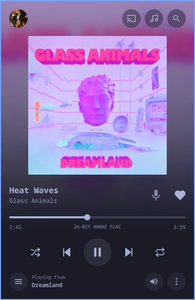
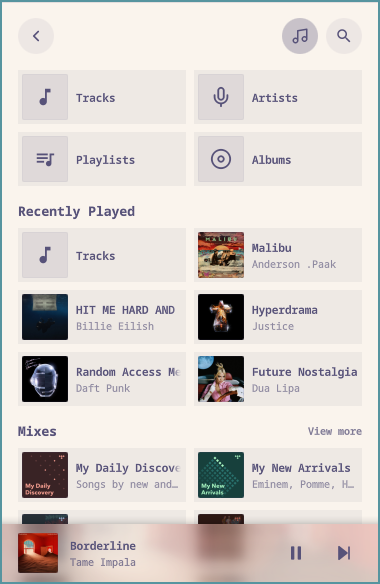
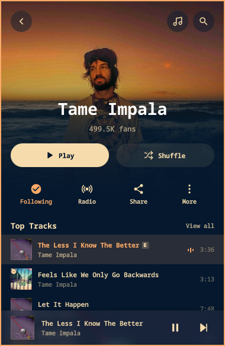

# TIDAL Player for Omarchy

**True Hi-Res lossless TIDAL, native to your Omarchy bar.**

Stream up to 24-bit/192 kHz FLAC straight to PipeWire — or cast losslessly to Chromecast devices — without an Electron window or browser tab in sight. A lightweight Rust daemon drives playback, MPRIS, and casting while the entire interface lives natively in your Omarchy shell and adapts live to your theme.

| Now Playing *(Tokyo Night)* | Music Library *(Rose Pine)* | Artist Page *(Retro 82)* |
| :---: | :---: | :---: |
|  |  |  |

## Highlights

- **Hi-Res Lossless to PipeWire** — Streams up to 24-bit/192 kHz FLAC via a supervised `mpv` backend with next-track preloading for instant gapless skips, in-memory seeking, persistent playhead state, and automatic stream recovery across suspend/resume.
- **Lossless Chromecast Streaming** — Cast directly to Chromecast, Google TV, and speaker groups with zero transcoding (direct DASH manifest handoff), live device volume sync, and seamless playback hand-off back to your desktop.
- **Complete Native UI** — Now Playing with animated covers and blurred glass backdrops, click-to-seek synced lyrics, play queue, library browser (Tracks, Artists, Playlists, Albums, Recently Played, Mixes), universal search, artist discographies and bios, and inline playlist editing — all styled live with your active Omarchy theme.
- **Bar Widget & Volume OSD** — Compact track info and artwork right in your bar. Scroll to adjust volume (up to 150% locally) with a dedicated TIDAL volume toast, `Ctrl`+scroll to seek, middle-click to play/pause, and use mouse back/forward to skip tracks.
- **Keyboard-First & Scriptable** — Direct vim-friendly shortcuts throughout the panel (`?` opens the built-in shortcut reference), global MPRIS2 media-key support, shell IPC for Hyprland bindings, and a standalone CLI.

## Requirements

- [Omarchy](https://omarchy.org/) 4+ (Quickshell)
- A paid TIDAL subscription
- PipeWire and `mpv`

## Install

```bash
omarchy plugin add https://github.com/scorchedegg/omarchy-tidalplayer --enable
```

The plugin automatically sets up and starts its user daemon on first load (no boot service is left behind if you disable the plugin). Click the TIDAL widget in your bar — or run `omarchy shell tidalplayer open` — to sign in with your TIDAL account.

### Optional Hyprland Keybinding

Bind a shortcut in `~/.config/hypr/bindings.lua` to toggle the panel from anywhere:

```lua
o.bind("SUPER + M", "Toggle TIDAL Player", "omarchy shell tidalplayer toggle")
```

Global media keys work out of the box through MPRIS2.

## Uninstall

```bash
omarchy shell tidalplayer uninstall
```

Stops the daemon, removes its systemd user unit, disables and removes the plugin, and clears saved session, queue, and runtime state (asks for confirmation first; pass `--yes` to skip).

## Keyboard Shortcuts

Press `?` inside the panel at any time for the full reference.

| Keys | Action |
| --- | --- |
| `Space` | Play / pause |
| `<` `>` | Previous / next track |
| `,` `.` | Seek back / forward 10 s |
| `-` `+` | Volume down / up (5% steps) |
| `s` / `r` | Toggle shuffle / repeat |
| `/` · `m` · `c` · `q` · `y` | Search · Music · Cast · Queue · Lyrics |
| `M` · `a` / `A` · `S` · `R` | Page menu · Add / remove · Share · Go to radio |
| `e` · `Shift+↑/↓` · `Del` · `Ctrl+S` | Edit own playlist · Reorder · Remove · Save |
| `↑` `↓` `k` `j` · `←` `→` `h` `l` | Navigate lists, pills, and grids |
| `Enter` / `Shift+Enter` | Open row · Play all / shuffle all (no selection) |
| `Backspace` / `Shift+Backspace` | Back / forward one view |
| `Esc` | Close sheet · Back · Close panel |

## Shell IPC & CLI

Control the panel and jump straight to any view from scripts or keybindings via Omarchy shell IPC:

```bash
omarchy shell tidalplayer toggle          # open or close the panel
omarchy shell tidalplayer search "flume"  # open search with a query
omarchy shell tidalplayer cast            # open the cast device sheet
omarchy shell tidalplayer help            # list all shell commands
```

Control playback, casting, account, and the daemon directly from the terminal with the bundled binary (`~/.config/omarchy/plugins/scorchedegg.tidalplayer/bin/omarchy-tidalplayer`):

```bash
omarchy-tidalplayer status                # playback state, track, and audio format
omarchy-tidalplayer cast list             # list discovered Cast devices
omarchy-tidalplayer lyrics                # print lyrics for the current track
omarchy-tidalplayer help                  # list all CLI commands
```

## Building from Source

A stripped `x86_64` release binary ships in `bin/omarchy-tidalplayer`, so no Rust toolchain is required on `x86_64`. On ARM64 / Apple Silicon (Omarchy M or Try Omarchy) — or to rebuild from source and run the test suite (requires Rust/`cargo`):

```bash
./scripts/build-daemon.sh
node --test tests/js.test.mjs
(cd daemon && dbus-run-session -- cargo test --locked)
```

## License

[MIT](LICENSE) © 2026 Saul Fautley. Not affiliated with or endorsed by TIDAL.
